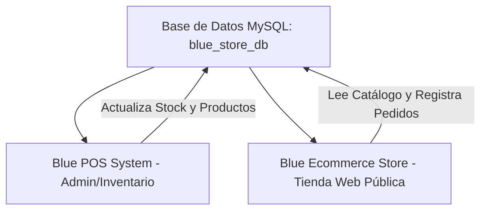

<p align="center">
  
</p>

<h1 align="center">Blue Ecommerce Store — Modern Online Web Shop</h1>

<p align="center">
  
  
  
  
  
</p>

<p align="center">
  <b>Tienda web ecommerce moderna, ágil y responsive desarrollada en Laravel, conectada en tiempo real al sistema Blue POS.</b>
</p>

---

> [!NOTE]
> ### 👋 Un saludo del autor
> *¡Hola a todos! Este proyecto lo desarrollé en el **2024** como el canal de ventas online y vitrina digital para el ecosistema **Código Ártico**. Diseñado para trabajar de la mano con el sistema administrativo [Blue POS System](https://github.com/CodigoArtico/blue-pos-system), lo comparto de forma abierta para que cualquier emprendedor o programador pueda montar su propia tienda web moderna y recibir pedidos directamente.*

---

## 🚀 Características Principales

- 🛍️ **Catálogo de Productos en Tiempo Real:**
  - Los productos, precios, fotos, categorías y stock se sincronizan automáticamente desde el panel de control del POS.
- 🛒 **Carrito de Compras Dinámico:**
  - Experiencia fluida para agregar, editar cantidades y calcular totales de pedido con feedback auditivo y visual.
- 💳 **Pasarela de Pago con Mercado Pago:**
  - Integración preparada con credenciales de Mercado Pago para procesar pagos seguros con tarjetas y medios digitales.
- 📲 **Pedidos Directos por WhatsApp:**
  - Botón integrado en cada producto y en el checkout que genera automáticamente un mensaje con el detalle de la compra dirigido al número configurado del comercio.
- 👤 **Cuentas de Cliente y Perfil:**
  - Módulo de registro e inicio de sesión para compradores, seguimiento de órdenes y edición de datos de perfil.
- 📱 **Diseño 100% Adaptable (Responsive):**
  - Maquetado con **TailwindCSS** para garantizar una navegación rápida y atractiva tanto en dispositivos móviles como en pantallas de escritorio.

---

## 🏛️ Arquitectura: Base de Datos Compartida

Esta tienda está pensada para conectarse a la **misma base de datos** del panel [Blue POS System](https://github.com/CodigoArtico/blue-pos-system). 



Al compartir base de datos:
1. No necesitas duplicar productos ni sincronizar APIs externas.
2. Cada venta en el POS físico descuenta el stock visible en la web.
3. Las compras web quedan registradas para su despacho.

---

## 📋 Requisitos Previos

- **PHP** >= 8.2 (con extensiones: `pdo_mysql`, `openssl`, `mbstring`, `curl`, `fileinfo`)
- **Composer** (v2.x)
- **Node.js** >= 18.x y **NPM**
- **MySQL** >= 8.0 (con el esquema de [Blue POS System](https://github.com/CodigoArtico/blue-pos-system) ya migrado)

---

## 🛠️ Instalación y Puesta en Marcha

### 1. Clonar el Repositorio
```bash
git clone https://github.com/CodigoArtico/blue-ecommerce-store.git
cd blue-ecommerce-store
```

### 2. Instalar Dependencias
```bash
composer install
npm install
```

### 3. Configurar Variables de Entorno (`.env`)
```bash
# En Windows (PowerShell):
copy .env.example .env

# En Linux / macOS:
cp .env.example .env
```

Genera la clave de la aplicación:
```bash
php artisan key:generate
```

Abre tu archivo `.env` y apunta a la misma base de datos creada para el POS:
```env
DB_CONNECTION=mysql
DB_HOST=127.0.0.1
DB_PORT=3306
DB_DATABASE=blue_store_db
DB_USERNAME=root
DB_PASSWORD=
```

*(Opcional)* Si deseas habilitar pagos online, añade tus credenciales de Mercado Pago:
```env
MERCADO_PAGO_ACCESS_TOKEN=tu_access_token_aqui
MERCADO_PAGO_PUBLIC_KEY=tu_public_key_aqui
```

### 4. Ejecutar Migraciones Complementarias
Si ya ejecutaste las migraciones del POS, aquí solo correrás las tablas propias de la tienda (ej. testimonios):
```bash
php artisan migrate
```

### 5. Enlace Simbólico de Almacenamiento
Para compartir y mostrar las fotos de productos subidas desde el POS:
```bash
php artisan storage:link
```

### 6. Compilar Assets y Levantar en Puerto Alternativo
Para ejecutar simultáneamente el POS y la Tienda Web en la misma computadora, levanta la tienda en el puerto `8080`:

En una terminal:
```bash
npm run dev
# o para producción: npm run build
```

En otra terminal:
```bash
php artisan serve --port=8080
```

¡Listo! Accede a tu tienda web en: **`http://localhost:8080`**

---

## 🔗 Ecosistema Conectado

* 🛒 **Panel Administrativo & POS:** [blue-pos-system](https://github.com/CodigoArtico/blue-pos-system)
* 🛍️ **Tienda Online Ecommerce:** [blue-ecommerce-store](https://github.com/CodigoArtico/blue-ecommerce-store) *(Este repositorio)*

---

## 💬 Contacto & Redes

- **Telegram:** [@codigoartico](https://t.me/codigoartico)
- **TikTok:** [@codigoartico](https://www.tiktok.com/@codigoartico)
- **GitHub:** [CodigoArtico](https://github.com/CodigoArtico)

---

## 📜 Licencia

Distribuido bajo la Licencia **MIT**. Consulta el archivo `LICENSE` para más información.  
Desarrollado con dedicación por **Código Ártico** (2024).